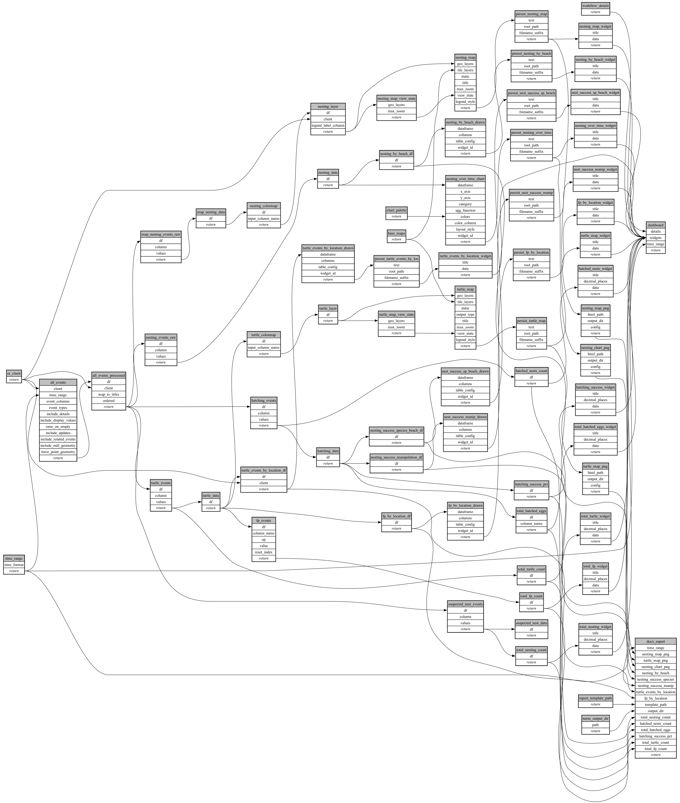

```
# AUTOGENERATED BY ECOSCOPE-WORKFLOWS; see fingerprint in README.md for details

```

```yaml
# fingerprint:
artifacts_sha256_basic: d779ab4d38ca81600f6418699a2de904aea4d3d82de715ec9a4fc6e41b01101e
artifacts_sha256_strict: 8bc254f15ad9614736d96f8bfc81f553db1392167387d91b725f3e547ce10876
installed_requirements:
- channel: https://repo.prefix.dev/ecoscope-workflows/
  name: ecoscope-platform
  version: {version: ==2.27.1}
- channel: https://repo.prefix.dev/ecoscope-workflows-custom/
  name: ecoscope-workflows-ext-custom
  version: {version: ==0.1.0rc24}
- channel: conda-forge
  name: pydeck
  version: {version: ==0.9.2}
- channel: https://repo.prefix.dev/ecoscope-workflows-custom/
  name: ecoscope-workflows-ext-curacao
  version: {version: ==0.0.8}
params_sha256: 7b775d948cccf6da18e72e7b01738631423e72b3ba533661e85477d30bfcf967
spec_sha256: bce956f1fa52a28c79daa342324eb40fb76d7e691d2b3156156b25d14b11aab1

```

# ecoscope-workflows-turtle-monitoring-workflow


